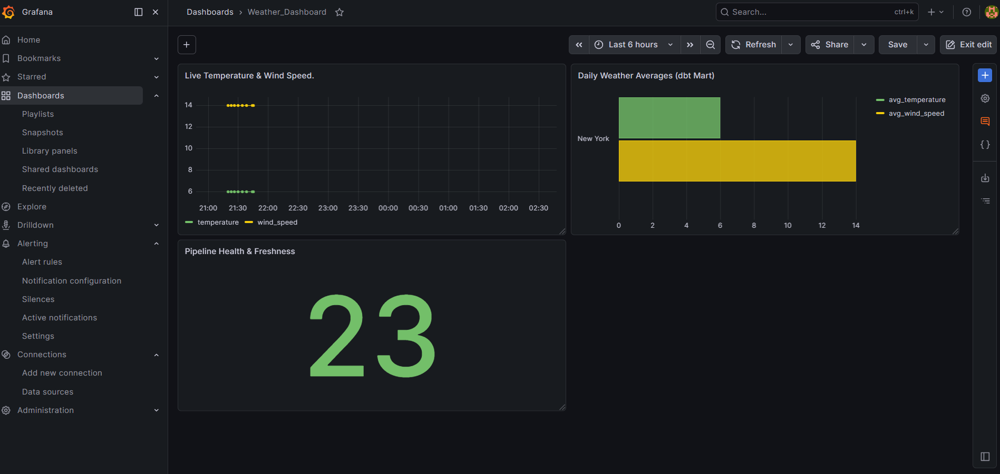

# Automated Weather ELT & Observability Pipeline

An end-to-end, containerized ELT data platform that ingests live meteorological data from the Weatherstack API, loads raw records into PostgreSQL, transforms and validates analytics models with dbt, orchestrates workflows via Apache Airflow, and monitors metrics and pipeline health in Grafana.

## Architecture

    Weatherstack API ──▶ Python Ingestion ──▶ PostgreSQL (dev.raw_weather_data)
                                                     │
                                                     ▼
                                              dbt Transformations
                                          ┌──────────┴──────────┐
                                          ▼                     ▼
                                 dev.stg_weather_data   dev.daily_average
                                 dev.weather_report
                                          │                     │
                                          └──────────┬──────────┘
                                                     ▼
                                           Grafana Observability
                                     (Live Metrics & Pipeline Health)

                   [ Orchestrated by Apache Airflow (DockerOperator) ]

## Tech Stack
* **Ingestion:** Python (`requests`, `psycopg2`)
* **Data Warehouse:** PostgreSQL 14
* **Transformation & Data Quality:** dbt Core (`dbt-postgres` 1.9) with `unique` and `not_null` schema assertions
* **Orchestration:** Apache Airflow 3 (`PythonOperator` + `DockerOperator`)
* **Visualization & Observability:** Grafana OSS
* **Infrastructure:** Docker & Docker Compose

## Data Modeling & Quality (`dbt`)
* **Raw Layer (`dev.raw_weather_data`):** Appends raw API snapshots with UTC ingestion timestamps.
* **Staging Layer (`dev.stg_weather_data`):** Deduplicates records using `ROW_NUMBER() OVER (PARTITION BY id ORDER BY inserted_at DESC)` and normalizes UTC offsets into local timestamps (`inserted_at_local`).
* **Mart Layer (`dev.weather_report`, `dev.daily_average`):** Materializes time-series reporting tables and daily aggregated temperature and wind speed KPIs.
* **Automated Testing (`dbt build`):** Enforces primary key uniqueness and non-null constraints across staging and mart models before downstream tables update.

## Key Engineering Decisions
* **Replaced Superset + Redis with Grafana:** Eliminated 3 heavy containers and external bootstrap scripts in favor of a single lightweight Grafana container wired directly to PostgreSQL for native time-series rendering and row-count freshness monitoring.
* **Containerized Task Isolation:** Configured Airflow's `DockerOperator` with host Docker socket group permissions (`group_add`) and bridge networking so dbt runs in an isolated container triggered sequentially after API ingestion.
* **Environment-Driven Configuration:** Decoupled API keys and database credentials from source code using `.env` injection across Python and Docker Compose.

## Quickstart

1. **Clone the repository and configure environment variables:**

       git clone https://github.com/Basitrehmankhattak/weather_data_project.git
       cd weather_data_project
       cp .env.example .env
       # Add your WEATHERSTACK_API_KEY inside .env

2. **Launch the containerized stack:**

       docker compose up -d

3. **Access the services:**
   * **Apache Airflow:** `http://localhost:8000` (unpause and trigger `weather-api-dbt-orchestrator`)
   * **Grafana:** `http://localhost:3000` (default login: `admin` / `admin`; connect PostgreSQL host `db:5432`, database `db`)
